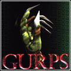
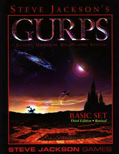
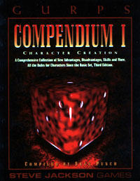
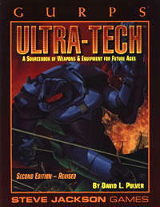
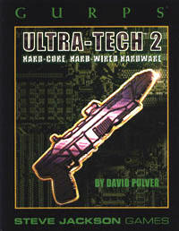
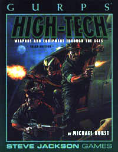
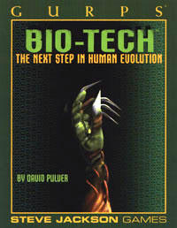
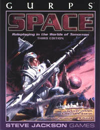
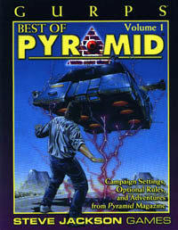
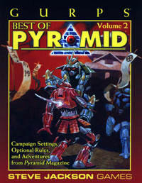

# GURPS: hoard

С ролевой системой GURPS у меня сложились довольно странные отношения. Я давно уже ей интересуюсь, прочитал много книг, но так и не провел с ее помощью ни единого приключения. Не сложилось. Вместе с тем, я довольно хорошо знаком со всем, что было Стивом Джексоном со компанией рождено на свет, так что вот вам мой список заслуживающих внимания книг по GURPS с оценками, комментариями и рекомендациями.

Для начала давайте расставим все точки над i. GURPS - замечательная система для всего, что требует более-менее реального моделирования мира, но для волшебной героики гурпс противопоказан. Нужна героическая фэнтези - замечательно, ничего лучше второй редакции AD&D для этого еще не придумано (о том, почему я предпочитаю вторую редакцию третьей, я расскажу как-нибудь потом), а гурпс оставим для других сеттингов. Таким образом, из рассмотрения исключаются все книги соответствующего направления, такие, например, как [GURPS Magic](http://www.amazon.com/exec/obidos/tg/detail/-/1556342861/qid=1060872537/sr=1-9/ref=sr_1_9/102-5719060-3599359?v=glance&s=books) или [GURPS Fantasy Folk](http://www.amazon.com/exec/obidos/tg/detail/-/1556343094/ref=pd_bxgy_text_1/102-5719060-3599359?v=glance&s=books&st=*). GURPS Magiс, впрочем, может пригодиться, если в кампэйне используется тот или иной вид техно-магии. Все это, конечно, мое сугубое имхо, ведь если издают гурпсатую фэнтезятину, значит, кто-то ее покупает.

Гурпс - это хайтек, киберпанк, скайфай, постапокалиптик, стимпанк, все, что угодно, но не героическая фэнтези!

Книги по GURPS, в общем-то, без особенных проблем можно найти в сети. В электронном же виде все это было в первый раз мною прочитано, но, как водится, захотелось найти понравившиеся книги в бумажном виде. Удобнее пользоваться, и есть, что гостям в руках вертеть :)

Итак, к делу. Снимаю с полки стопку книжек c красочными обложками (кстати, покупалось это все через [Amazon](http://www.exelenz.ru/misc/amazon/)), и выбираю пару самых толстых, среди них - единственный в стопке хардковер.

**[GURPS Basic Set](http://www.amazon.com/exec/obidos/tg/detail/-/1556343574/qid=1060872537/sr=1-1/ref=sr_1_1/102-5719060-3599359?v=glance&s=books)** - это собственно, и есть GURPS. Единственная по настоящему базовая книга системы, в принципе, ее достаточно для того, чтобы начать (и продолжить) играть. После долгого перерыва, в 2002 году, была выпущена новая, 3яя редакция книги, и именно ее следует покупать. Впрочем, это вам не d&d, и от редакции к редакции сама система фактически не менялась, все изменения лишь в оформлении книги и объеме вспомогательной информации. В отличии от Wizards of the Coast, Steve Jackson Games редко выпускает книги в жестких обложках, и Basic Set - редкое исключение. Эту книгу вы будете открывать чаще других, так что без жесткой обложки она долго не проживет. Книга замечательная, иметь ее необходимо.

**[GURPS Compendium I](http://www.amazon.com/exec/obidos/tg/detail/-/155634290X/ref=pd_sim_books_1/102-5719060-3599359?v=glance&s=books%20target=)** - вторая «базовая» книга системы, посвящена созданию персонажей. По большому счету, это просто энциклопедия различных скиллов, адвантаджей и дизадвантаджей, собранных в одно место из всех ранее выпущенных книг. Необходимый минимум всего этого есть и в Basic Set, но здесь-то его много! Всегда ведь хочется сделать своего персонажа особенным. Книга очень полезна, саму по себе ее читать не слишком-то интересно, но в игре пригодится. Иметь ее очень желательно.

**[GURPS Ultra Tech](http://www.amazon.com/exec/obidos/tg/detail/-/1556341644/ref=pd_sim_books_2/102-5719060-3599359?v=glance&s=books)** (A Sourcebook of Weapons and Equipment for Future Ages). Играем по будущему? Нужно оружие, медикаменты, транспорт? Попали по адресу, все это есть в GURPS Ultra Tech. Книга разбита на разделы по классам оборудования, внутри классов девайсы отсортированы по уровню технологического развития. Есть довольно полезные заметки о том, как то или иное технологическое новшество может повлиять на общество. Забавно, но в целом взгляд на будущее цивилизации в этой книге довольно оптимистичен, после GURPS Cyberpunk смотрится довольно странно. Можно обойтись и без нее, но с ней жизнь будет легче. Рекомендуется иметь.

**[GURPS Ultra Tech 2](http://www.amazon.com/exec/obidos/tg/detail/-/155634337X/ref=pd_sim_books_2/102-5719060-3599359?v=glance&s=books)** (Hard-Core, Hard-Wired Hardware). Еще больше ультратеха, киберварь, имплантаты, оружие, армор, нанотех, отравляющие газы - все, что душе угодно. Никаких откровений, но ведь большая часть шарма высокотехнологичного мира именно в мелочах, так? И этого здесь хватает. Иметь эту книгу на своей книжной полке не помешает.

**[GURPS High Tech](http://www.amazon.com/exec/obidos/ASIN/1556343582/qid=1060872537/sr=2-3/ref=sr_2_3/102-5719060-3599359)** (Weapons and Equipment Through the Ages). С этой книгой наблюдается некоторая путаница - посмотрев на название, можно подумать, что речь пойдет о высоких технологиях будущего. Но нет, на самом деле в книге рассматривается период от изобретения пороха до современности, а техника будущего - это уже GURPS Ultra Tech. Если не обращать внимания на различие в названии и содержании, то книга хороша. Дана популярная история огнестрельного оружия, от личного стрелкового до тактической артиллерии. Рекомендую купить и переименовать в GURPS: Огнестрельное Оружие.

**[GURPS Bio Tech](http://www.amazon.com/exec/obidos/tg/detail/-/1556343361/ref=pd_sim_books_2/102-5719060-3599359?v=glance&s=books)**. Сталь и кремний - это все в прошлом. Ты сам можешь стать оружием, компьютером, всем, чем угодно. С плоти все начиналось и к ней же все и вернулось - генетические модификации, клонирование, нано-симбионты, самые различные биотехнологии, все это позволяет сделать со своим телом все, что угодно, сделать _из_ своего тела все, что угодно. Отличная книга, масса интересного материала, очень рекомендую!

**[GURPS Space](http://www.amazon.com/exec/obidos/tg/detail/-/1556343906/qid=1060955228/sr=1-1/ref=sr_1_1/102-5719060-3599359?v=glance&s=books)**. В этой книге есть все, что потребуется для космической кампании - космические корабли, навигация в космосе, инопланетные расы, новые миры. Все это универсально в лучшем гурпсовском смысле, используя предложенные правила можно расписать все, что угодно. Отлично написано, интересно читается, описываемые физические принципы достаточно похожи на правду. С этой книгой все просто - надо пойти и заказать. Общепризнанно одна из лучших книг по GURPS.

**[GURPS Russia](http://www.amazon.com/exec/obidos/ASIN/1556342586/qid%3D1060956040/sr%3D11-1/ref%3Dsr_11_1/102-5719060-3599359)**. В отличие от всех остальных рассмотренных здесь книг, это не набор правил, а конкретный сеттинг, собственно, средневековая Русь. Книга была куплена их праздного интереса - что же эти буржуи могут про нас написать. Как это ни странно, но книга хороша, большая часть информации адекватна, чего-то я даже и не знал. Хорошо читается. Конечно, играть по этому мы не будем, но прочитать было забавно. Покупать не надо, а вот взять почитать у кого-нибудь вполне можно.

**[GURPS Best of Pyramid 1](http://www.amazon.com/exec/obidos/tg/detail/-/1556344945/qid=1060880669/sr=1-1/ref=sr_1_1/102-5719060-3599359?v=glance&s=books)** и **[GURPS Best of Pyramid 2](http://www.amazon.com/exec/obidos/tg/detail/-/1556345429/qid=1060880669/sr=1-2/ref=sr_1_2/102-5719060-3599359?v=glance&s=books)**. Как и все уважающие себя игродельческие компании, SJGames выпускает свои журналы, в том числе и онлайновый «Pyramid». В нем публикуют приключения, новые правила, сеттинги и много еще всего интересного. Журнал хоть и онлайновый, но платный. И вот, кому-то в голову пришла гениальная мысль - собрать материал, за который однажды уже были получены деньги, напечатать его, и получить деньги еще раз :) Так вот и появились эти сборники Best of Pyramid. Почитать, в общем, интересно, но покупать их все же не стоит, если, конечно, вы не законченный фанатик.

----

На этом моя подборка литературы по GURPS заканчивается. Этих книг вполне достаточно для того, чтобы провести любое приключение по современности или альтернативному будущему. Впрочем, осталось несколько книг, которые неплохо было бы присоединить к этой подборке, по разным причинам достать их на данный момент не получилось.

1. **[GURPS Cyberpunk](http://www.amazon.com/exec/obidos/tg/detail/-/1556341687/qid=1060956829/sr=1-1/ref=sr_1_1/102-5719060-3599359?v=glance&s=books)** - самая, наверное, известная книга Стива Джексона, кто не слышал истории о ее конфискации ФБР, как пособия для хакеров? Было это в стародавние времена, когда еще существовала illuminati bbs. Самое то, что надо, для тех, кто неравнодушен к киберпанку. Очень ее хочу, но, увы, она давно out of print. Можно заказать напрямую в SJGames, но это дорого и в Россию не факт, что нормально доедет.
2. **[GURPS Compendium II](http://www.amazon.com/exec/obidos/tg/detail/-/1556343272/ref=pd_sim_books_2/102-5719060-3599359?v=glance&s=books)** - третья базовая книга системы, сборник правил на все, что можно. Нужна в первую очередь мастерам, и иметь ее было бы очень неплохо - для комплекта.
3. **[GURPS Illuminati](http://www.amazon.com/exec/obidos/ASIN/1556342233/qid=1060872537/sr=2-2/ref=sr_2_2/102-5719060-3599359)** - теория заговора во всех ее видах. Очень симпатичный сеттинг и очень хорошая книга. Если вы больны паранойей, то это еще не значит, что за вами не следят, так?
4. **[GURPS Warehouse 23](http://www.amazon.com/exec/obidos/ASIN/1556343280/qid%3D1060959138/sr%3D11-1/ref%3Dsr_11_1/102-5719060-3599359)** - эту книгу я хочу больше всего! Подборка самых невероятных артефактов, как техногенного так и волшебного происхождения. Очень полезно само по себе, никакой привязки к GURPS, по большому счету, нет.
5. **[GURPS SpecOps](http://www.amazon.com/exec/obidos/tg/detail/-/1556346255/qid=1060957841/sr=1-5/ref=sr_1_5/102-5719060-3599359?v=glance&s=books)** - информация по специальным подразделениям, от группы Альфа до US Navy Seals. Забавно, умеренно полезно, но мне такие книжки нравятся.
6. **[GURPS Vehicles](http://www.amazon.com/exec/obidos/tg/detail/-/1556343256/qid=1060958460/sr=1-1/ref=sr_1_1/102-5719060-3599359?v=glance&s=books)** - правила на все, что движется. Машины, танки, самолеты. Полезно.
7. **[GURPS Martial Arts](http://www.amazon.com/exec/obidos/tg/detail/-/1556343140/qid=1060958621/sr=1-1/ref=sr_1_1/102-5719060-3599359?v=glance&s=books)** - правила для рукопашного боя, мой кун-фу сильнее твоего и все такое. Умеренно полезно, но может пригодиться.
8. **[GURPS Psionics](http://www.amazon.com/exec/obidos/tg/detail/-/1556341962/ref=pd_sim_books_5/102-5719060-3599359?v=glance&s=books)** - базовые правила по псионике есть и в Basic Set, но если я вдруг надумаю внедрять псионику в свои игры, то эта книга не помешает.
9. **[Gurps Cyberworld](http://www.amazon.com/exec/obidos/tg/detail/-/1556342357/102-5719060-3599359?v=glance&me=ATVPDKIKX0DER&st=books)** - судя по всему, еще немножко киберпанка.  Поставив эти книги на свою книжную полку я смогу уверенно сказать - "теперь у меня есть все, что может мне потребоваться для игры по GURPS". Наступит счастье - до тех пор, конечно, пока SJGames не издадут что-нибудь новое и интересное :)
