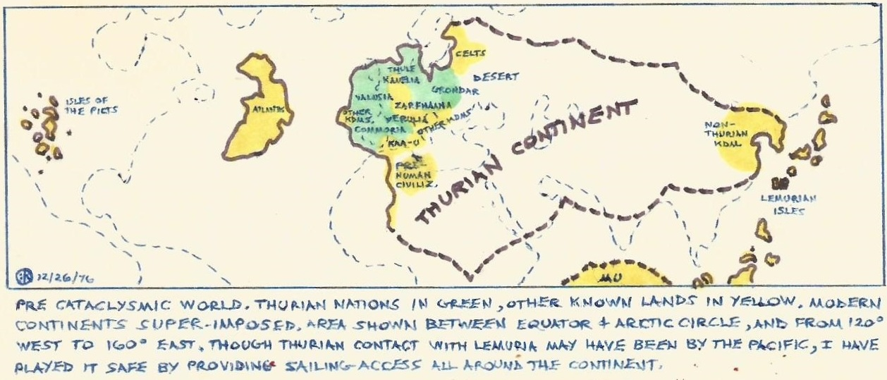
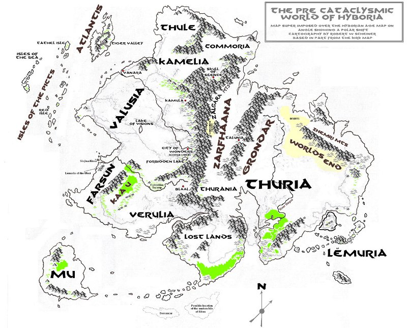
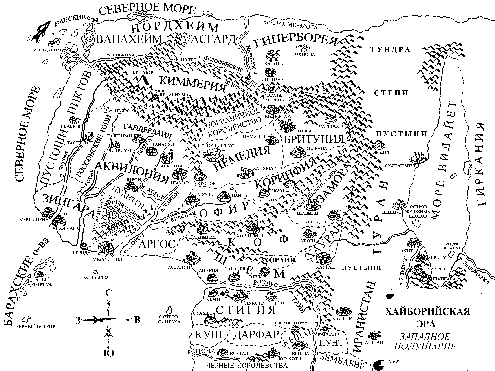
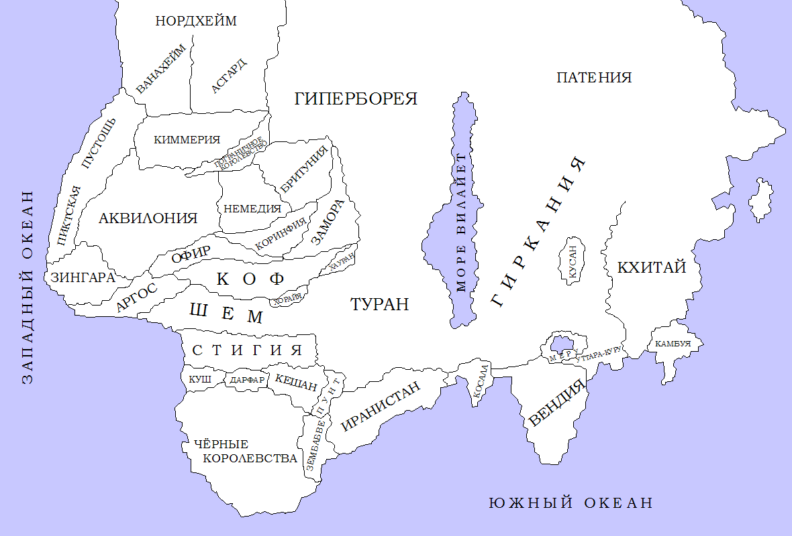
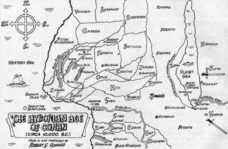
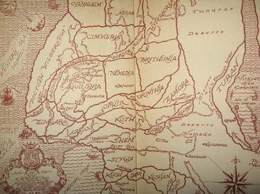
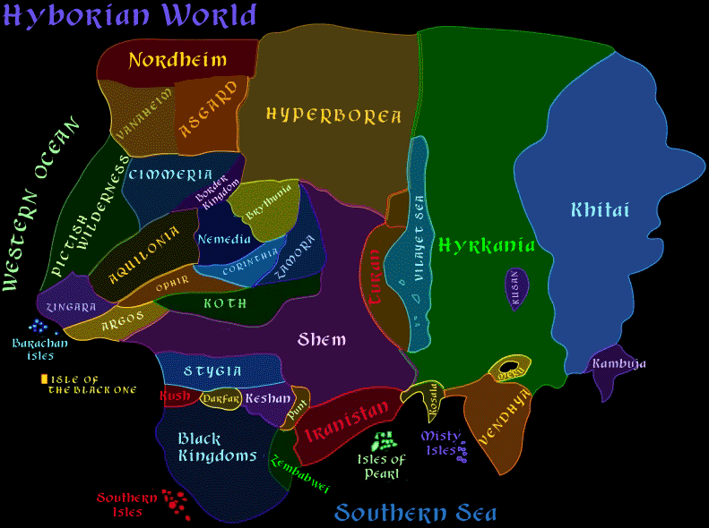
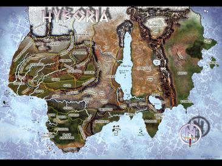
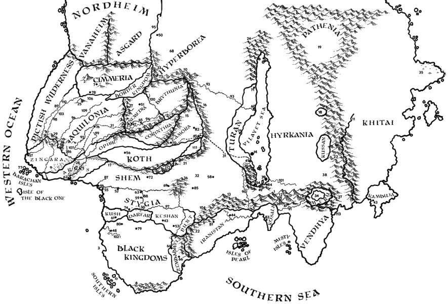

# Карты

 
Турийская эра

Запад Турийского материка в Хайборийскую эру

Турийский материк

An illustration of The Hyborian Age primarily based upon a map hand-drawn by Robert E. Howard in March 1932.

Another version of the map, drawn by David Kyle for the 1950 Gnome Press edition of Conan the Conqueror.

A larger map of Earth in Robert E. Howard's Hyborian Age.

Map of Hyboria
